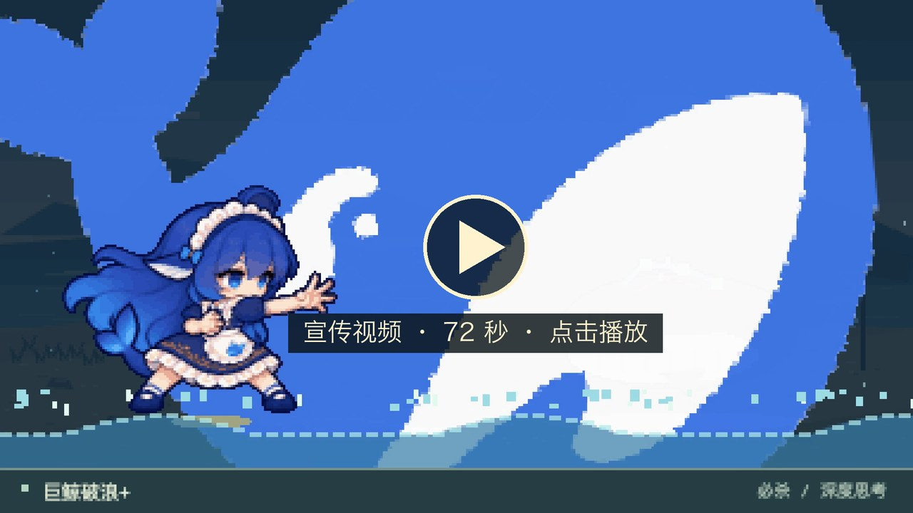
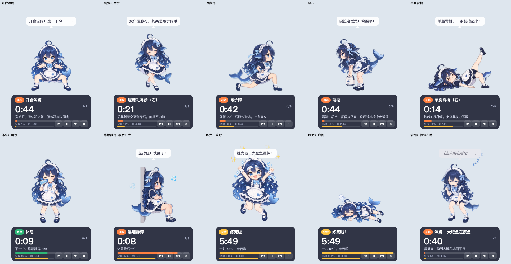
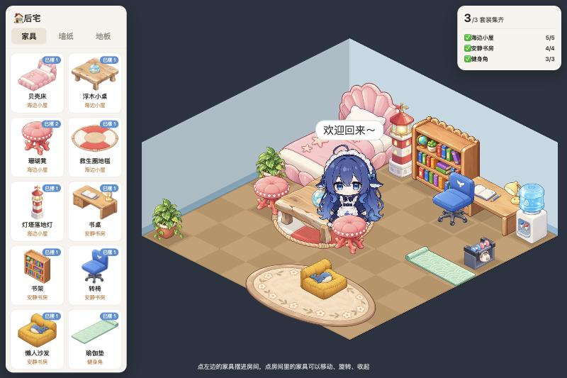

# 大肥鱼 🐋

给 DeepSeek 二创形象「鲸鱼娘·大肥鱼」做的**桌面宠物**，外加一个独立的网页爬塔游戏。

- **桌宠**（仓库根目录，Python + PySide6）：在桌面上散步、互动、做表情、播动作动画，还能带你健身跟练
- **爬塔**（[`tower/`](tower/README.md)，网页游戏）：仿《杀戮尖塔》的像素卡牌 roguelike，15 层地图选路打到关底 Boss。桌宠单击面板里的 🗼 或右键「🗼 爬塔」直接在浏览器里打开

### 爬塔宣传视频

[](docs/tower-promo.mp4)

72 秒，1080p（[`docs/tower-promo.mp4`](docs/tower-promo.mp4)）：选路地图 → 鲸尾连击 → 战斗奖励 → 问号事件 → 错峰小卖部 → 铁盆精英 → 宝箱 → Bug 房里的波峰波谷 → 打盹点 → 关底黑鲸，攒满「已思考 10 秒」，最后放出巨鲸破浪。
画面是游戏实机逐帧录的，牌序和敌人血量事先排好；配乐用 ACE-Step 生成，音效是游戏自己的。

### 跟练宣传视频

[](docs/workout-promo.mp4)

30 秒，1080×1920 竖屏（[`docs/workout-promo.mp4`](docs/workout-promo.mp4)）：准备倒计时 → 开合深蹲 → 拎电饭煲硬拉 →
站着睡着吹鼻涕泡、偷偷干白饭、托腮「深度思考」，每次都被抓包 → 另外 4 种偷懒 → 练完欢呼再瘫倒，魂飞出来。
画面是桌宠跟练实机逐帧录的，偷懒挑哪段事先指定；气泡字比桌宠里稍大一点，手机上看得清。
配乐用 ACE-Step 生成，提示音和语音播报是跟练自己的。

### 喝水提醒宣传视频

[](docs/water-promo.mp4)

39 秒，1080×1920 竖屏（[`docs/water-promo.mp4`](docs/water-promo.mp4)）：开头先放大招，扔大水砸碎屏幕 →
到点递水壶 → 不理她，走到鼠标旁边示范喝水 → 咚咚咚敲屏幕、搬出 1.5L 大水 → 大水攻击，碎屏，「本鲸记下了」气跑出屏幕 →
菜单栏「大肥鱼服务器暂时不可用」→ 自己回来，没喝就进抠门模式，戳她只回「嗯。」→ 右键「我喝了」，干杯和好。
画面是桌宠喝水提醒实机逐帧录的，跑在一块竖屏大小的虚拟屏幕上，走到鼠标旁边、走出屏幕、碎屏位置都和真屏幕上一样；
台词事先指定，桌面上的代码窗口、鼠标和右键菜单是画上去的。配乐用 ACE-Step 生成，碎屏那一下的提示音是桌宠自己的。

之前的飞行棋已经移除，最后一个完整版本留在标签 `flying-chess-archive` 上（`git checkout flying-chess-archive`）。

## 桌宠

保留了 [dafeiyu-pet](https://github.com/1190fasheqi/dafeiyu-pet) 的全部功能：

- **三视图行走**：自由散步 / 跟随鼠标 / 原地待着；左右走用侧面（自动镜像），向上背面、向下正面
- **互动**：拖拽（会侧身朝拖动方向）；单击蹦一下、回嘴，并弹出功能面板（🗨️ 聊天、🗼 爬塔、🏋️ 跟练、🏠 后宅）；双击喂食（小鱼干 / 蛋糕 / 棒棒糖 / 团子 / 钻石）
- **台词**：日常台词、互动回嘴、思维链心声（灰色斜体括号气泡）
- **AI 对话**：调用 DeepSeek API，Key 在右键「设置 Key」里填，存在本地 `config.json`
- **去 QQ / Discord 里聊天**：右键「🔗 连接 IM」（或单击面板的 🔗），填上你自己建的机器人的密钥，她就用自己的身份回大家的话，
  聊到开心时桌面上的她也会冒泡。只能聊天，碰不到你的电脑；有白名单和回复上限。怎么建机器人见 [`docs/im-bots.md`](docs/im-bots.md)
- **天气**：右键「查看天气」，城市在「设置城市」里改
- **系统监控**：CPU、内存过高时冒泡提醒（Windows 有 NVIDIA 显卡时还会看显卡温度）
- **右键菜单 / 托盘**（macOS 是菜单栏图标）：🗼 爬塔、模式、大小、显示 / 隐藏、回到屏幕内、鼠标穿透、窗口置顶、开机自启、退出

新增：

- **做个表情**：右键「做个表情」，可以选随机或指定表情；闲着时也会偶尔自己做一个
- **动作动画**：搬来了 [dsh-pet](https://github.com/PC2005-cloud/dsh-pet) 的 92 段透明动画（舞狮头、玩玩具汽车、玩魔方、涮火锅、放烟花、撸猫……），
  在「做个表情」里按 小动作 / 互动 / 玩耍 / 吃什么 / 时节 / 文字 分类挑；闲着时也会自己随机播一段（每段 10 秒，拖一下就停）
- 右键菜单补上了「喂食」「说句话」「设置城市」
- **健身跟练**：右键「🏋️ 跟练」或单击面板的 🏋️，见下面
- **喝水提醒**：默认开，每 45 分钟提醒一次，不理她会一级级加码，见下面
- **后宅**：单击面板的 🏠 或右键「🏠 后宅」，在浏览器里给她布置房间，见下面

### 表情

素材只有正面、侧面、背面三张图，所以表情用「身体动作 + 头顶符号」来表现。共 11 种：


开心（蹦跳 + ✨🎵）· 生气（发抖 + 💢）· 害羞（扭捏 + 💗）· 晕乎乎（原地转一圈半 + 💫）· 犯困（歪头 + 💤）·
震惊（跳起 + ❗）· 疑惑（歪头 + ❓）· 得意（鼓起来 + ✨）· 委屈（发抖 + 💧）· 比心（❤️）· 口渴（蔫下来 + 💧）。
另外还有喂食时的吃东西动作。

### 动作动画

dsh-pet 的动画是同一个大肥鱼形象的完整视频（640×360、24 帧、VP9 透明 webm），放在角色包的 `characters/dafeiyu/clips/`。
播的时候人物按待机动画的身高缩放到桌宠大小、脚底对齐，开头结尾和正面图淡入淡出；
吹气球、放风筝这类比人宽的，桌宠窗口会临时撑大，播完缩回来。
用 [PyAV](https://github.com/PyAV-Org/PyAV) 边播边解码（自带 libvpx，不用另装 ffmpeg），没装 PyAV 时这些动作不出现，其他功能照常。

### 健身跟练

大肥鱼按训练计划带你练：每个动作她都会做给你看，气泡里报下一个动作，右上角一个两位数倒计时（红色是练、绿色是歇，
外圈是这一段的进度，下面小字是第几个动作 / 第几轮）。单击大肥鱼暂停 / 继续，右键菜单里能重来、跳过、结束。
最后 3 秒滴答提示，macOS 上还会语音报「开始，弓步蹲」「休息 15 秒，下一个，硬拉」。

- 内置 Kris（THENX）的 [6 分钟腿部训练（不跳）](https://www.bilibili.com/video/BV17Z4y1M7YV/)：开合深蹲 → 屈膝礼弓步（左右各 22 秒）→
  弓步蹲 → 硬拉 → 臀桥（双腿、右、左各 15 秒）→ 靠墙静蹲，动作 45 秒、休息 15 秒，菜单「轮数」可以连练几轮
- 动作是原子化的，可以自己编排：在 `workouts/` 里写 JSON（菜单「打开计划文件夹…」有示例），格式和可用动作见
  [`content/workout/README.md`](content/workout/README.md)；「动作预览」能单独看每个动作
- 她有自己的人设动作：休息时先喘气再喝水，最后 10 秒冒汗发抖，练完欢呼再瘫倒（魂飞出来又钻回去）
- 她会随机偷懒，8 种：站着打瞌睡吹鼻涕泡、偷刷手机、掏电饭煲干白饭、托腮「深度思考」、躺平摆烂、偷吃小鱼干、
  假装在练、抱着尾巴打盹——每次都是 站好 → 偷懒 → 「被发现了！」→ 站好，回到站姿才接着练



跟练动画是 Seedance 2.5 照着原版正面立绘（`characters/dafeiyu/sprites/正面.png`）生成的绿幕视频，抠成透明 webm（`characters/dafeiyu/workout/clips/`）。
每段的首帧和尾帧都是同一张正面图，所以动作、偷懒、喝水之间怎么接都不会跳；躺着练的臀桥、蹲着的靠墙静蹲拆成
躺下 / 循环 / 起身三段。提示词和流程见 [`content/workout/README.md`](content/workout/README.md)，同样适用 CC BY-NC-SA 4.0。
没装 PyAV 时退回旧的一套：ChatGPT 画的姿势帧按关键帧时间轴播。

### 喝水提醒

默认开，人在电脑前每 45 分钟提醒一次（右键「💧 喝水提醒」里能改成 30 / 60 / 90 分钟、关掉、今天别提醒了）。
不理她就每 5 分钟加码一次：

| 时间 | 她做什么 |
| --- | --- |
| 到点 | 掏出小水壶朝你递过来晃晃（两种，轮着来） |
| +5 分钟 | 走到鼠标旁边，自己先咕嘟咕嘟喝给你看 |
| +10 分钟 | 隔着屏幕咚咚咚敲玻璃，再搬出一瓶 1.5L 大水立在脚边：「严肃实践大水理论！」 |
| +15 分钟 | 拖出一瓶比她还高的大水朝你扔过来——屏幕「碎」了，水顺着裂缝往下流；她叉腰「哼！」，转身气鼓鼓走出屏幕 |

**单击她就是「喝了」**：和你干杯，头顶喷出一道小水柱挂着彩虹，报今天第几杯（一天 8 杯，喝满再放一段蓝鲸现世）。
右键里也有「我喝了」和「等会儿再提醒（10 分钟）」。

气跑以后托盘提示变成「大肥鱼服务器暂时不可用」，「叫她回来」只会回你「服务器繁忙，请稍后再试」。
三五分钟后她从跑出去的那边走回来：这期间你喝了（单击托盘菜单「我喝了」），她不好意思地挠头比心；
没喝，她别别扭扭地把水递给你，然后进入 10 分钟「抠门模式」——单击只回「嗯。」「哦。」「省 token 中。」，喝了水才和好。

不打扰的规矩：键鼠 5 分钟没动算你不在，停止计时，离开 15 分钟以上回来先提醒一次；22:00–9:00 不提醒；
跟练、拖她、聊天时先不提醒，空下来再说。碎屏是一层点得穿的透明窗口，不挡你干活，几秒后自己消失。
右键「💧 喝水提醒 → 预览」能直接看每一级（预览气跑只离开 8 秒）。

动画和跟练动画是同一套做法（Seedance 2.5 首尾帧 + 绿幕抠像），离场那段停在侧面站姿、返场两段从侧面站姿开始，
好和走路的侧面图接上；提示词在 [`tools/make_water_clips.py`](tools/make_water_clips.py)，素材说明见
[`characters/dafeiyu/water/README.md`](characters/dafeiyu/water/README.md)。没装 PyAV 或素材缺失时换成表情动作，流程照走。

### 后宅

一个 8×8 的等距视角小屋：左边挑家具摆进去（旋转、移动、收起），换墙纸地板。家具都免费，没有货币。
家具分成「海边小屋」「安静书房」「健身角」三个套装，右上角显示每套摆齐了几件，集齐时弹提示。
她也住在房间里：走来走去，走到家具的姿势槽位上坐着、躺着、睡觉、看书、锻炼、喝水。



布局存在 `room.json`（和 `config.json` 同一个目录）。桌宠在 127.0.0.1 上起一个只有本机能访问、要带 token 的小服务，
网页通过它读写布局；家具是代码画的原创图，可以商用。目录格式、姿势槽位、开发和以后怎么迁到 Electron 见 [`room/README.md`](room/README.md)。

### 角色包

引擎和角色是分开的：大肥鱼的立绘、动画、台词、人设和授权都在 [`characters/dafeiyu/`](characters/dafeiyu/) 里，
由 `character.json` 描述。换角色只换包、不改代码（`DFY_CHARACTER=<包名> python main.py`）；
包里缺哪类动画，对应功能按原来的方式降级（比如没有跟练动画就用姿势帧，没有喝水动画就用表情）。
格式和动画约定见 [`characters/README.md`](characters/README.md)。大肥鱼包不可商用，见 [`characters/dafeiyu/LICENSE.md`](characters/dafeiyu/LICENSE.md)。

## 运行

桌宠需要 Python 3.9+。已在 macOS 26（Apple Silicon）+ Python 3.12 / 3.14 上实测；Windows 理论上可以运行，但还没实测。

**macOS 双击启动**：在 Finder 里双击 `启动大肥鱼.command`。
第一次会自动建虚拟环境并安装依赖（约 400 MB，视网速要等几分钟），之后就秒开；以后依赖有更新，它也会自动补装。
桌宠运行时会开着一个终端窗口，关掉它桌宠也会退出。
如果是下载 zip 解压的，系统可能提示"无法验证开发者"：右键这个文件 → 打开 → 再点一次打开即可。

**命令行启动**：

```bash
python3 -m venv .venv
source .venv/bin/activate        # Windows: .venv\Scripts\activate
pip install -r requirements.txt
python main.py
```

### 装进 DeepSeek Harness（dsh 插件）

整个仓库也是一个 dsh 插件包 `dsh-dfy-pet`：装上以后 dsh 一开，大肥鱼就出现在桌面上，dsh 退出时一起退。

```bash
npm pack                                             # 打出 dsh-dfy-pet-<版本>.tgz（约 100 MB）
dsh plugin --profile web add /绝对路径/dsh-dfy-pet-0.1.0.tgz
```

`<profile>` 按你用的界面填：`dsh web` 填 `web`，桌面版填 `desktop`。发布到 npm 以后改成 `dsh plugin --profile web add dsh-dfy-pet`，或者在插件页的「添加插件」里填 `dsh-dfy-pet`。
tgz 的路径别太长（放在临时目录深处时 pnpm 会报 `ENAMETOOLONG`）。

- **Python 环境**：插件第一次启动时在 `~/.dsh/plugins-data/dfy-pet/venv` 建虚拟环境，装 `requirements.txt`。
  有 [uv](https://docs.astral.sh/uv/) 就用 uv，优先用系统里的 Python，没有就让 uv 下载一个，所以没装 Python 的机器也能跑；没有 uv 时退回系统 `python3 -m venv` + pip。
  第一次要下载 PySide6，等一两分钟；之后 `requirements.txt` 不变就直接复用。
- **数据**：配置、自己写的训练计划、macOS 的 `大肥鱼.app` 外壳都放在 `~/.dsh/plugins-data/dfy-pet/`，升级插件不会丢（桌宠代码在 dsh 的 `node_modules` 里，升级会整个换掉）。
- **QQ 里聊天**（不想装 dsh 的话，桌宠也能直连 QQ 开放平台，见 [`docs/im-bots.md`](docs/im-bots.md)）：再装官方的 QQ 机器人插件 `@tencent-connect/dsh-qqbot`，在 dsh 的「QQ 机器人」里用手机 QQ 扫码绑定，
  然后在 profile 的 `cordis.patch.yml`（`~/.dsh/profiles/web/cordis.patch.yml`）里加上下面几行，QQ 里的人就是在和大肥鱼聊：

  ```yaml
  - id: im-qqbot
    config:
      preset: dfy-qq
  ```

  `dfy-qq` 这个 preset 是本插件带的：系统提示词只有大肥鱼的人设，工具只有 `dafeiyu_desktop`（让主人桌面上的大肥鱼冒一句话、做个表情、跳一段，20 秒最多一次），**没有 shell 和文件工具**。
  不设它的话 QQ 会话用 dsh 的标准模式，带 bash 和文件读写，审批按钮还会发给 QQ 里聊天的人，等于让陌生人在你电脑上跑命令。
- **dsh 怎么指挥桌宠**：插件把桌宠当子进程起（`DFY_CONTROL=stdin`），往它的 stdin 一行写一条 JSON，格式见 [`control.py`](control.py)；管道断了桌宠就退出。

### 爬塔

从桌宠点 🗼（单击面板或右键菜单）就能玩，不需要装 node：桌宠会用系统浏览器打开仓库里打包好的 `content/tower/index.html`。
爬塔和桌宠只共用这个入口，存档、货币（塔里是 Token）都是分开的。

改爬塔的代码要装 node：

```bash
cd tower
npm install
npm run dev        # 开发，浏览器打开 http://localhost:5173
npm test           # 规则测试
npm run release    # 重新打包并更新 content/tower/，改完代码记得跑一次再提交
```

`content/tower/SOURCE_HASH` 记着打包时的源码哈希，`python -m unittest discover -s tests` 会检查它和 `tower/` 的源码对得上。详见 [tower/README.md](tower/README.md)。

## 文件

| 文件 | 说明 |
|------|------|
| `main.py` | 入口；托盘、配置保存 |
| `pet.py` | 桌宠本体（移植自 dafeiyu-pet 的 `桌宠.py`） |
| `expressions.py` | 表情动作 |
| `clips.py` | 动作动画播放器（PyAV 解码透明 webm） |
| `workout.py` | 健身跟练：原子动作、训练计划、计时和角色的人设动作 |
| `character.py` | 角色包加载：按 `character.json` 找立绘、动画、台词、人设；`DFY_CHARACTER` 换包 |
| `characters/` | 角色包，一个角色一个目录，格式见 [`characters/README.md`](characters/README.md) |
| `characters/dafeiyu/` | 默认角色包「大肥鱼」：立绘（`sprites/`，来自 dafeiyu-pet）、动作动画（`clips/`）、跟练动画和姿势帧（`workout/`）、喝水动画（`water/`）、台词和人设（`character.json`）。**非商用** |
| `content/workout/` | 内置训练计划（`plans/`）和跟练素材说明 |
| `tools/make_workout_clips.py` | 用 Seedance 生成跟练动画（提示词都在这里），抠绿幕后写进当前角色包的 `workout/clips/` |
| `tools/make_workout_frames.py` | 把生成的姿势原图裁边、统一大小、算脚底锚点，写进当前角色包的 `workout/frames/` |
| `workouts/` | 自己写的训练计划（不进 git） |
| `water.py` | 喝水提醒：计时和升级的状态机、碎屏特效（台词在角色包里） |
| `tools/make_water_clips.py` | 用 Seedance 生成喝水提醒的动画（提示词都在这里），抠绿幕后写进当前角色包的 `water/clips/` |
| `tools/import_clips.py` | 从 dsh-pet 的 `assets/webm` 导入动作动画，算人物外框、写进当前角色包的 `clips/` |
| `common.py` | 路径、平台差异（字体、窗口标志）、配置、精灵加载 |
| `启动大肥鱼.command` | macOS 双击启动脚本 |
| `tower/` | 爬塔（Vite + TypeScript），和桌宠不共用代码，见 [tower/README.md](tower/README.md) |
| `content/tower/` | 爬塔打包好的单文件网页（`npm run release` 生成，提交进仓库），桌宠的 🗼 入口打开它 |
| `room.py` | 后宅的数据：家具目录、布局校验、套装进度、存档、本机 HTTP 服务 |
| `room/` | 后宅网页（Vite + TypeScript + PixiJS），见 [room/README.md](room/README.md) |
| `content/room/` | 后宅的家具目录（`catalog.json`）和打包好的单文件网页（`npm run release` 生成，提交进仓库） |
| `build/大肥鱼.app` | macOS 上启动时自动生成：把解释器放进这个壳里运行，程序坞和 ⌘Tab 就显示「大肥鱼」而不是 Python |
| `control.py` | dsh 插件指挥桌宠的 stdin 通道（说话、表情、动作动画、显示）；IM 机器人的桌面联动也用它的指令格式 |
| `llm.py` | 调 DeepSeek 对话接口，聊天框和 IM 机器人共用 |
| `im/` | IM 机器人：QQ（开放平台直连）、Discord 适配器，白名单、限流、人设、「🔗 连接 IM」设置窗，见 [`docs/im-bots.md`](docs/im-bots.md) |
| `package.json`、`cordis.patch.yml` | dsh 插件包清单和挂载声明（宿主插件 + QQ 用的 `dfy-qq` preset） |
| `dsh/` | dsh 插件的 Node 部分：`index.js` 起桌宠子进程，`python-env.js` 建 Python 环境，`tool.js` 是 QQ 会话里的 `dafeiyu_desktop` 工具 |

## 致谢与引用

- **[1190fasheqi/dafeiyu-pet](https://github.com/1190fasheqi/dafeiyu-pet)**（MIT）：大肥鱼透明桌宠。
  - 精灵图（`characters/dafeiyu/sprites/`，取自提交 `5b0e018`）直接沿用。
  - `pet.py` 移植自它的 `桌宠.py`，包括台词、散步 / 跟随逻辑、喂食、AI 对话、天气、系统监控、菜单。其中 AI 对话、天气、系统监控由 [Cpanoe](https://github.com/Cpanoe) 贡献给原项目。
  - 在此基础上的改动：macOS 适配（鼠标穿透改用 Qt 自带标志、开机自启改用 LaunchAgent、字体按平台选、窗口不用 Tool 标志）；天气查询改到后台线程；修复了双击后会多触发一次单击的问题；新增表情系统。
  - 它的原始许可证保留在 [`LICENSE-dafeiyu-pet`](LICENSE-dafeiyu-pet)。
- **[PC2005-cloud/dsh-pet](https://github.com/PC2005-cloud/dsh-pet)**：DeepSeek Harness 桌宠。它的代码和素材是分开授权的：
  - 代码 MIT，许可证保留在 [`LICENSE-dsh-pet`](LICENSE-dsh-pet)。本项目只沿用了它 `config.jsonc` 里的随机动作分类（`characters/dafeiyu/clips/clips.json`）。
  - `characters/dafeiyu/clips/` 的 92 段动作动画取自它的 `dsh-pet/assets/webm`（提交 `dfc0396`），文件原样未改。**这些动画不适用 MIT**：
    素材允许开源使用、**禁止商用**，角色形象另受 [CC BY-NC-SA 4.0](https://creativecommons.org/licenses/by-nc-sa/4.0/deed.zh-hans) 约束；署名和条款详见 [`characters/dafeiyu/clips/LICENSE.md`](characters/dafeiyu/clips/LICENSE.md)。
- 「鲸鱼娘·大肥鱼」是 DeepSeek 社区的二创形象（非 DeepSeek 官方形象），角色形象的权利归原作者 / 相关权利人；
  形象作者声明其适用 [CC BY-NC-SA 4.0](https://creativecommons.org/licenses/by-nc-sa/4.0/deed.zh-hans)，作者署名见 [`characters/dafeiyu/clips/LICENSE.md`](characters/dafeiyu/clips/LICENSE.md)。
  本项目为非商业同人作品，如需商用请先联系素材作者。
- 界面使用 [PySide6](https://doc.qt.io/qtforpython-6/)（Qt for Python，LGPL）。

## 协议

本项目代码（引擎）采用 [MIT](LICENSE) 协议；移植自 dafeiyu-pet 的代码同时沿用上游的 MIT 许可。

角色相关的东西全在角色包里，**授权跟着包走**，每个包的 `character.json` 里 `license` 字段写明（`commercial` 是不是可商用）。
默认包 `characters/dafeiyu/` 整个**不在 MIT 范围内、不可商用**，见 [`characters/dafeiyu/LICENSE.md`](characters/dafeiyu/LICENSE.md)：
立绘、跟练动画、姿势帧、喝水动画、台词人设是「大肥鱼」形象及其衍生，适用 CC BY-NC-SA 4.0；
`clips/*.webm` 的动作动画另外沿用 dsh-pet 的素材条款（开源可用、禁止商用），见 [`characters/dafeiyu/clips/LICENSE.md`](characters/dafeiyu/clips/LICENSE.md)。
