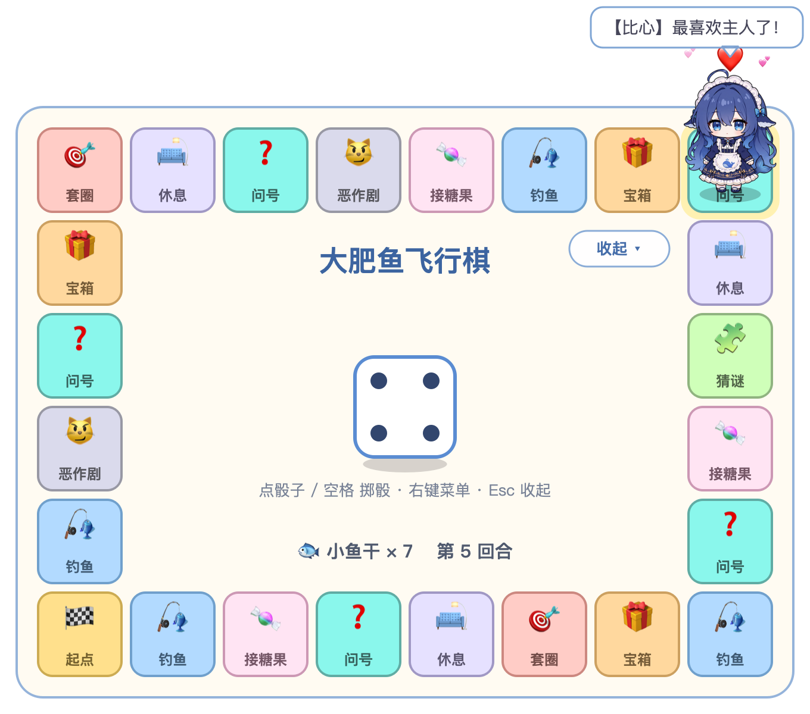

# 大肥鱼飞行棋 🎲🐋

给 DeepSeek 二创形象「鲸鱼娘·大肥鱼」做的**桌宠 + 飞行棋**。

- **棋盘展开**：大肥鱼在透明小棋盘上掷骰子、一格一格蹦过去，踩到格子触发事件
- **棋盘收起**：大肥鱼从当前格子跳回桌面，变回完整的桌宠，可以散步、互动、做表情



## 桌宠（棋盘收起时）

保留了 [dafeiyu-pet](https://github.com/1190fasheqi/dafeiyu-pet) 的全部功能：

- **三视图行走**：自由散步 / 跟随鼠标 / 原地待着；左右走用侧面（自动镜像），向上背面、向下正面
- **互动**：拖拽（会侧身朝拖动方向）；单击蹦一下、回嘴，并弹出功能面板（🗨️ 聊天 / 🎲 飞行棋）；双击喂食（小鱼干 / 蛋糕 / 棒棒糖 / 团子 / 钻石）
- **台词**：日常台词、互动回嘴、思维链心声（灰色斜体括号气泡）
- **AI 对话**：调用 DeepSeek API，Key 在右键「设置 Key」里填，存在本地 `config.json`
- **天气**：右键「查看天气」，城市在「设置城市」里改
- **系统监控**：CPU、内存过高时冒泡提醒（Windows 有 NVIDIA 显卡时还会看显卡温度）
- **右键菜单 / 托盘**（macOS 是菜单栏图标）：模式、大小、显示 / 隐藏、回到屏幕内、鼠标穿透、窗口置顶、开机自启、退出

新增：

- **做个表情**：右键「做个表情」，可以选随机或指定表情；闲着时也会偶尔自己做一个
- 右键菜单补上了「喂食」「说句话」「设置城市」「🎲 打开飞行棋」

### 表情

素材只有正面、侧面、背面三张图，所以表情用「身体动作 + 头顶符号」来表现。共 10 种：


开心（蹦跳 + ✨🎵）· 生气（发抖 + 💢）· 害羞（扭捏 + 💗）· 晕乎乎（原地转一圈半 + 💫）· 犯困（歪头 + 💤）·
震惊（跳起 + ❗）· 疑惑（歪头 + ❓）· 得意（鼓起来 + ✨）· 委屈（发抖 + 💧）· 比心（❤️）。
另外还有喂食时的吃东西动作。

## 飞行棋（棋盘展开时）

- 8×6 外圈共 24 格：起点 / **问号** / 钓鱼 / 套圈 / 接糖果 / 猜谜 / 宝箱 / 休息 / 恶作剧
- 点骰子或按空格掷骰；大肥鱼按方向切三视图，逐格蹦过去
- **问号格**：大肥鱼随机做一个表情（第一个做好的格子）
- 其他格子的小游戏还没做，目前只有台词和小鱼干奖励；经过起点发 3 个小鱼干；恶作剧格下回合暂停
- 点「收起」或按 Esc 收起棋盘，右键菜单里也有；在桌宠上单击后点 🎲，或右键「🎲 打开飞行棋」重新展开
- 棋盘进度（位置、小鱼干、回合）会保存在 `config.json`，下次打开接着玩

## 运行

需要 Python 3.9+。已在 macOS 26（Apple Silicon）+ Python 3.12 / 3.14 上实测；Windows 理论上可以运行，但还没实测。

**macOS 双击启动**：在 Finder 里双击 `启动大肥鱼飞行棋.command`。
第一次会自动建虚拟环境并安装依赖（约 360 MB，视网速要等几分钟），之后就秒开；以后依赖有更新，它也会自动补装。
游戏运行时会开着一个终端窗口，关掉它游戏也会退出。
如果是下载 zip 解压的，系统可能提示"无法验证开发者"：右键这个文件 → 打开 → 再点一次打开即可。

**命令行启动**：

```bash
python3 -m venv .venv
source .venv/bin/activate        # Windows: .venv\Scripts\activate
pip install -r requirements.txt
python main.py
```

在 macOS 上，程序名和程序坞图标目前显示为 Python。

## 文件

| 文件 | 说明 |
|------|------|
| `main.py` | 入口；管理桌宠和棋盘两个窗口的切换、托盘、配置保存 |
| `pet.py` | 桌宠本体（移植自 dafeiyu-pet 的 `桌宠.py`） |
| `board_game.py` | 飞行棋盘窗口：动画、绘制调度、输入 |
| `game/core/` | 纯规则（不依赖 Qt）：地图图结构、骰子、回合与起点工资、存档兼容 |
| `game/content/` | 读取并校验 `content/` 下的配置 |
| `game/render/` | 格子、骰子绘制器 |
| `content/tiles.toml` | 格子类型：名字、图标、颜色、落地事件 |
| `content/maps/<地图>/map.toml` | 地图：节点、连线、坐标 |
| `content/dice/<皮肤>/dice.toml` | 骰子皮肤：颜色、圆角、点位、动画时长，可选贴图 |
| `expressions.py` | 表情动作，桌宠和棋盘共用 |
| `common.py` | 路径、平台差异（字体、窗口标志）、配置、精灵加载 |
| `sprites/` | 精灵图（来自 dafeiyu-pet） |
| `启动大肥鱼飞行棋.command` | macOS 双击启动脚本 |

## 换地图 / 换骰子皮肤

- 新地图：复制 `content/maps/classic/` 改名后编辑 `map.toml`，再把 `config.json` 里的 `board_map` 改成目录名。
- 新骰子：复制 `content/dice/classic/` 改颜色，或放 `1.png`~`6.png` 并写 `face_dir`；`config.json` 里的 `dice_skin` 改成目录名。
- 改完先校验，配置写错时会指出是哪个文件哪一项：

```bash
python -m game.content check
python -m unittest discover -s tests
```

## 后续计划

1. 每种格子接一个轻量小游戏（钓鱼、接糖果、猜谜……），输了也给安慰小鱼干
2. 心情值 / 装饰兑换
3. 让大肥鱼用 DeepSeek 对掷骰结果吐槽

## 致谢与引用

- **[1190fasheqi/dafeiyu-pet](https://github.com/1190fasheqi/dafeiyu-pet)**（MIT）：大肥鱼透明桌宠。
  - 精灵图（`sprites/`，取自提交 `5b0e018`）直接沿用。
  - `pet.py` 移植自它的 `桌宠.py`，包括台词、散步 / 跟随逻辑、喂食、AI 对话、天气、系统监控、菜单。其中 AI 对话、天气、系统监控由 [Cpanoe](https://github.com/Cpanoe) 贡献给原项目。
  - 在此基础上的改动：macOS 适配（鼠标穿透改用 Qt 自带标志、开机自启改用 LaunchAgent、字体按平台选、窗口不用 Tool 标志）；天气查询改到后台线程；修复了双击后会多触发一次单击的问题；新增表情系统和飞行棋切换。
  - 它的原始许可证保留在 [`LICENSE-dafeiyu-pet`](LICENSE-dafeiyu-pet)。
- 「鲸鱼娘·大肥鱼」是 DeepSeek 社区的二创形象，角色形象的权利归原作者 / 相关权利人。
  本项目为非商业同人作品，如需商用请先联系素材作者。
- 格子玩法灵感来自飞行棋和大富翁。
- 界面使用 [PySide6](https://doc.qt.io/qtforpython-6/)（Qt for Python，LGPL）。

## 协议

本项目代码采用 [MIT](LICENSE) 协议；`sprites/` 目录和移植自 dafeiyu-pet 的代码同时沿用上游的 MIT 许可，并受上面的角色形象说明约束。
