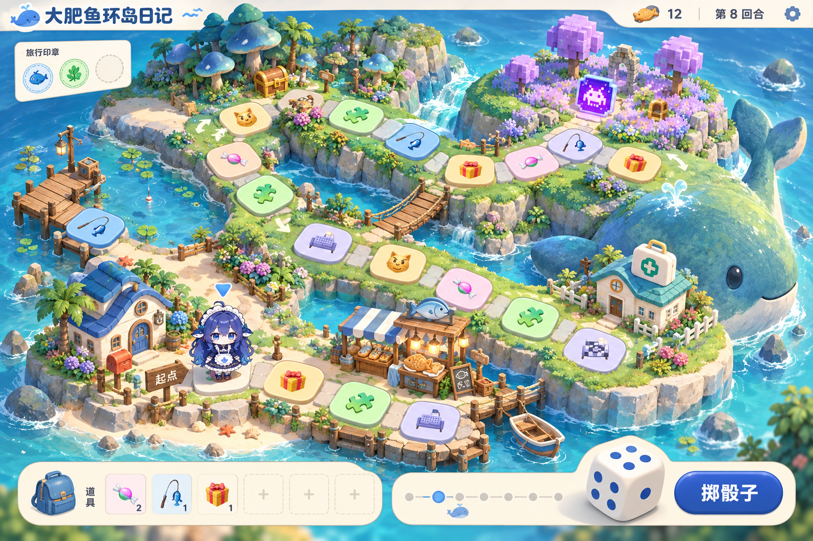
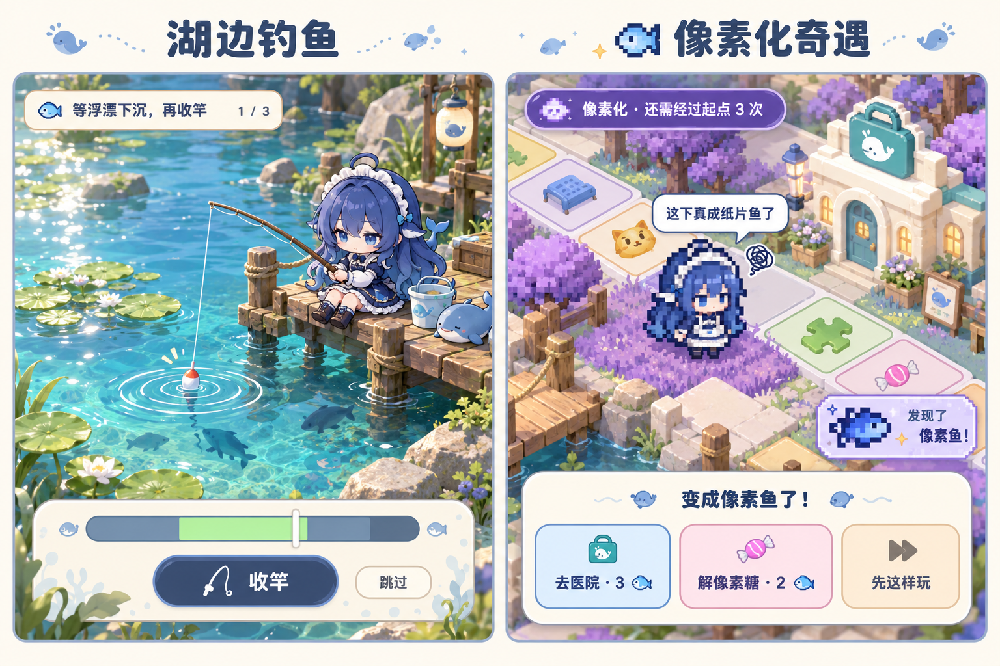
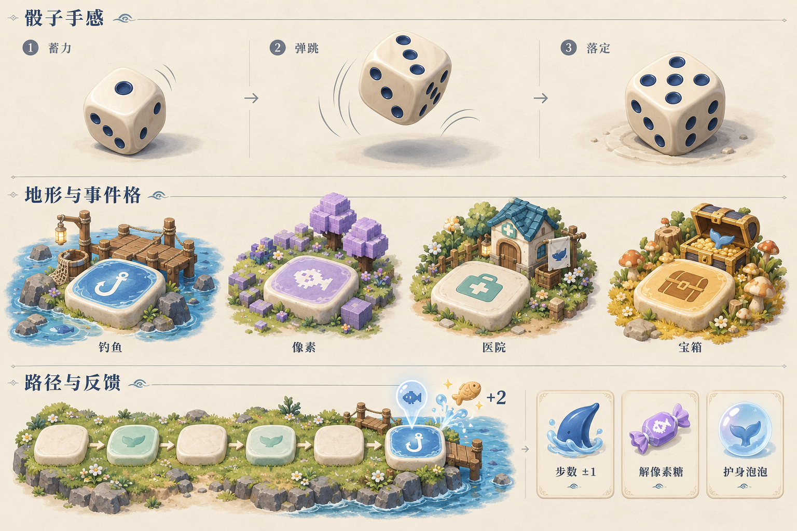

# 大肥鱼环岛日记：玩法与美术提案

核心体验：带大肥鱼在一座小岛上散步、钓鱼、遇到奇怪的事，再带着故事回到桌面。保留“掷骰子走格子”的易懂操作，加入目的地、轻决策和有利有弊的状态。

这是交给开发者的设计包，包含 3 张内置 GPT Image 参考图、完整开发 prompt 和生成提示词。此次只新增设计资料，没有改动游戏实现。主玩法按当前项目的单人桌宠定位设计；多人竞赛放到以后。

## 1. 现在为什么显得单调

- 格子是等大的彩色按钮，只有颜色与 emoji 区分，缺少“这是一个地方”的感觉。
- 路线贴着矩形边缘，中间空白占比大，骰子与标题挤占了地图的位置。
- 玩家只能掷骰子，事件大多是随机加钱或暂停，缺少“我想去那里”的动机。
- 钓鱼、套圈等在当前代码里还只是台词与随机奖励，没有实际操作。

改进顺序：先建立能辨认的地形与路线，再做落地反馈和骰子，最后用可玩的事件把地图串起来。

## 2. 美术方向：桌面上的微缩鲸鱼岛

采用固定相机的 2.5D 手绘微缩景观：柔和草坡、蓝色水面、奶油色石板、木桥与小房子。沿用现有蓝发鲸鱼娘角色，场景做柔和边缘，避免角色像贴纸一样浮在背景上。

| 区域 | 地形识别 | 对应玩法 | 低成本环境动画 |
| --- | --- | --- | --- |
| 海边小屋 | 蓝屋顶、信箱、沙滩 | 起点工资、旅行手册 | 风铃、旗帜 |
| 湖畔 | 湖、荷叶、码头、鱼影 | 钓鱼小游戏、鱼类图鉴 | 浮漂、水纹 |
| 蘑菇林 | 蘑菇、树荫、宝箱 | 安全采集 / 冒险采集 | 萤火点、树叶 |
| 像素遗迹 | 紫色方块树、阶梯状草地 | 像素化、专属收藏 | 低频方块粒子 |
| 小镇 | 商店、薄荷色医疗包标识 | 道具补给、治疗 | 招牌轻摇 |

地图至少占内容区约 75%，HUD 贴边，骰子放右下角。事件格使用同一套石板形状和材质，以图形、纹理、颜色共同区分。文字在悬停或聚焦后显示，不让每一格都挤着标签。

图片中的节点数量、连线和少量图标仅供美术参考。程序路线必须来自独立地图配置，不能依据生成图的石板数量编码。

## 3. 核心循环：想去哪 → 做选择 → 留下故事

1. 看旅行手册，选择这次想收集的东西。
2. 掷骰，看到本回合的路线与落点预览。
3. 可使用一次步数调整道具，也可在分岔选择路线。
4. 路过码头、林间驿站、商店、医院时，可以停靠并放弃剩余步数。
5. 进行一个短事件，得到鱼干、收藏、状态或一条旅行记录。
6. 大肥鱼对结果吐槽；收起棋盘后，状态和收藏继续保留。

普通回合目标约 3–6 秒；小游戏控制在 10–15 秒内。这些是设计目标，后续需实际试玩验证。动画加速和小游戏跳过始终可用。

可以借鉴《马里奥派对》的“骰子推进 + 道具决策 + 小游戏 + 长期目标”结构。任天堂官方对其玩法也强调掷骰、棋盘、小游戏和收集目标：[官方玩法介绍](https://www.nintendo.com/us/store/products/super-mario-party-jamboree-120369/)。本项目使用自己的角色、岛屿、事件与奖励。

## 4. 两个招牌玩法

### 钓鱼：短、能掌握、值得回来

停靠码头后，浮漂先抖动，鱼咬钩时出现时机条，点击或按空格收竿。每次最多 3 次尝试，总时长不超过 15 秒。失败给 1 鱼干安慰奖；成功次数越多，奖励越高，最多 4 鱼干。收藏鱼进入图鉴，鱼干直接入账，不增加“卖鱼换钱”的操作负担。

普通状态收集普通鱼；像素状态能钓出像素鱼。首次在像素状态下至少成功一次，必得一条像素鱼作为收藏，之后才采用低概率重复收藏。让像素状态有一个立即看得见的好处。

### 像素化：一段可选择保留的奇遇

落在像素格后，大肥鱼和部分装饰界面变成像素风，台词变成“我被降采样了”“先别治，湖里有隐藏款”。保留清晰的文字、按钮、焦点与命中区域。

| 恢复方式 | 明确规则 |
| --- | --- |
| 自然恢复 | 状态获得后，正向经过起点 3 次；界面显示还剩几次 |
| 医院 | 路过可主动停靠，支付 3 鱼干立即恢复；不足 3 时提供免费援助 |
| 解像素糖 | 背包使用一颗立即恢复；商店价格 2 鱼干，每圈限购 1 颗 |

不减少骰子点数，不让小游戏更难，不暂停行动。重复踩像素格不刷新剩余圈数，也不叠加状态。

24 格主环的普通骰子期望一圈约 24 / 3.5 ≈ 6.9 回合，自然恢复约 20.6 回合，停靠和路线会改变实际时间。因此“3 次起点”适合当长期兜底，医院与道具必须好用。像素地带后方就放医院，既能治，也能主动保留去钓特殊鱼。

参考图右侧的恢复卡片是概念表达：实际“去医院”只做地图定位；只有到达医院才出现治疗按钮，不能从任何位置直接扣 3 鱼干远程治疗。

## 5. 让人想再走一圈的系统

- **旅行手册**：首个目标是湖畔、森林、像素三枚印章。小游戏认真尝试即可拿湖畔章，不要求技术满分。集齐送小屋摆件，不强制结束游戏。
- **路线取舍**：森林主路更稳，有驿站；紫色桥路更短，有像素格和额外宝箱。路口提前显示风险，玩家主动选择。
- **道具创造小计划**：步数 ±1 帮助够到目标，解像素糖提供退出状态的自由，护身泡泡抵挡一次状态或小恶作剧。
- **状态组合**：像素化去钓鱼能得到隐藏鱼，普通状态去医院则能领一句健康吐槽。先做少量明确组合，避免复杂状态堆叠。
- **旅行回顾**：记录“本想治病，转头去湖边钓到了像素鱼”之类的经历。先用本地模板和确定事件生成，接 LLM 只负责润色台词。
- **永久收藏**：鱼图鉴、小屋摆件与印章保留。新旅程重置的位置、鱼干和状态与永久收藏分开存储。

初版只使用鱼干一种可消耗货币。收藏鱼、印章与摆件不承担第二套货币功能。天气、多人、复杂任务链、几十种道具留到后续。

## 6. 骰子和落地为什么会好看

骰子是有厚度的奶油白圆角立方体，配深蓝凹陷圆点、统一高光和软阴影。点击后依次压缩、弹起旋转、落地回弹；动画约 0.9 秒。结果在掷骰开始时只抽取一次，最终朝上的点数由程序按真实结果绘制，不能把参考图里的骰面直接当结果。

移动保留现有逐格跳跃和三视图切换，增加落脚波纹、终点预告、奖励飞向鱼干计数。每次只突出一个主要反馈，背景动效低频循环。

## 7. 示例攻略：第一次带大肥鱼出门

1. 从小屋出发，背包里有一颗免费解像素糖；先别急着用。
2. 路过码头主动停靠，完成第一次钓鱼，获得湖畔印章和鱼干。即使 3 次都失误也有安慰奖。
3. 森林路口第一次选主路，在驿站选安全采集，拿森林印章；想体验像素捷径也可以，但会错过这一圈的驿站。
4. 踩像素格获得像素印章，先看变化，再决定要不要治疗。
5. 愿意收藏就保留像素状态，下一次去湖边争取像素鱼；想恢复就去后方医院或吃糖。
6. 三枚章齐全后领取小屋摆件。收起棋盘，大肥鱼回到桌面，仍记得这次旅行。

这是一条示例路线，不是强制新手脚本；实际停靠受骰子移动范围影响。

## 8. 给 Claude 的交接

把 [CLAUDE-PROMPT.md](CLAUDE-PROMPT.md) 的全文交给 Claude，并让它读取当前项目与 references/ 下的三张图。完整 prompt 明确了主环与分支、服务停靠、状态时序、存档迁移、UI 分层与验收场景。

建议按可运行增量完成：第一阶段完成美术骨架、骰子、钓鱼、像素化与医院；第二阶段补齐森林、分支、商店、道具与旅行手册；第三阶段再做更多小游戏和环境变化。

图中 UI 文案、路线和自动生成的骰面可能存在概念误差。正式版本应使用代码排字、代码定义图标与逻辑、独立可编辑图层；不要直接把三张概念图作为整个游戏截图背景。
